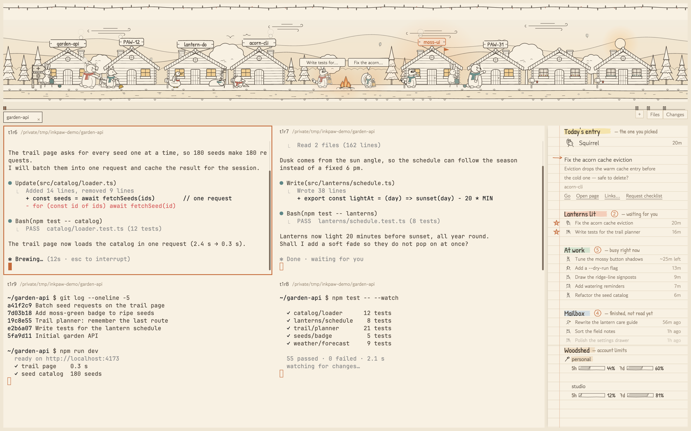

# Inkpaw Hollow

A cozy, hand-drawn working forest for Herdr: every terminal is an animal with a cabin, blocked work waits by a lantern-lit campfire, and a ruled-paper notebook keeps the day's sessions in ink.



## What it does

- **A working forest instead of a list.** Each space gets a cabin, each terminal an animal (bear, rabbit, fox, raccoon, cat, duck, hedgehog or squirrel) with a scarf. Working cabins smoke, done cabins raise their mailbox flag, blocked animals wait at the campfire with speech bubbles, idle animals sleep; a terminal whose agent has stopped reporting its status still gets an animal, resting.
- **Signboards, not tabs.** Hanging wooden planks name each space, with the ticket key when the name carries one (`PAW-12`, any `ABC-123`-shaped key). Click a plank to select the space; right-click for the space menu. While the forest has the keyboard, a matching plank drops from the vine reading `in the forest` and its keys.
- **A greeting from the picked animal.** The animal chosen with the keyboard turns to face you, waves, hops once and grows to 1.4×; it shrinks back the moment the keyboard moves to a terminal. Clicking an animal goes straight to its terminal.
- **A clothesline tab bar.** Paper tags hang from wooden pegs; working tags blink a firefly, blocked tags show an accent dot, done tags a red thread knot.
- **A keeper's notebook.** Today's entry, **Lanterns lit**, **At work** and **Mailbox**, with a stepping-stone checklist, page links, a paper link note and a search shared with the forest.
- **A woodshed.** One entry per account, each with two pencil gauges hatched up to the share used; the account this pane runs as keeps the axe and a wood-coloured highlighter over its name, and a window at 90 % or more turns accent with a red star.
- **A pencil-label pane header.** Status in words (`working`, `waiting`, `done`) and four pencil words on hover to split, zoom and close.
- **Search that spans both halves.** Type in the forest or the notebook; topic, title, space, tab, path, ticket and PR all match.
- **Paper and ink.** Gowun Dodum type on `#f8f1e3`, ink `#4b4239`, accent `#c46a3a`; every motion is a native Herdr loop, so the layout stays light.

More pictures: `media/forest.png` (the band close up) and `media/journal.png` (the notebook and woodshed).

## Install

Copy the mods, layout and theme into Herdr's home:

```sh
cp -R mods/inkpaw-* ~/.config/herdr-app/mods/
mkdir -p ~/.config/herdr-app/layouts ~/.config/herdr-app/themes
cp layouts/inkpaw-hollow.json layouts/inkpaw-hollow.png ~/.config/herdr-app/layouts/
cp themes/inkpaw-hollow.json ~/.config/herdr-app/themes/
```

Merge the `layout:inkpaw-hollow` section of this package's `keys.json` into `~/.config/herdr-app/keys.json` (add its keys; do not replace a key you already use). Then check every mod and switch:

```sh
for mod in inkpaw-forest inkpaw-journal inkpaw-shed inkpaw-tabs inkpaw-pane inkpaw-editor; do
  herdr-app check ~/.config/herdr-app/mods/$mod
done
herdr-app do layout.switch --name inkpaw-hollow
```

The forest needs `git` for its repository fences; the notebook needs `python3`, plus `ps` and `lsof` for the non-Claude agents. The woodshed works without `cca`, but shows no accounts until the bundled `cca` and `node` are available. Gowun Dodum ships inside every mod that draws type.

## Keyboard shortcuts

The layout's own section, `layout:inkpaw-hollow`:

| Key | Action |
|---|---|
| `ctrl-alt-p` | Move the keyboard into the forest, and back out |
| `ctrl-shift-a` | Open the accounts note |
| `cmd-=` / `cmd-+` | Bigger terminal text |
| `cmd--` | Smaller terminal text |
| `cmd-0` | Reset terminal text and zoom |
| `cmd-[` / `cmd-]` | Back / forward through visited terminals |

In the forest (while it has the keyboard):

| Key | Action |
|---|---|
| `←` `→` | Walk the firefly between animals |
| `⌥←` `⌥→` | First / last animal |
| `Space` | The session that waited longest for a reply |
| `⇧Space` | The oldest finished session |
| `↩` | Go to the chosen session |
| `Esc` | Clear the search, then the selection, then leave |
| `⌘⌫` | Clear the search |
| `?` | Fold or unfold the help note |
| any letters | Search |

In the notebook:

| Key | Action |
|---|---|
| `↑` `↓` | Choose a letter; on a checklist, open and scroll its steps |
| `Space` / `⇧Space` | Oldest reply / oldest finished |
| `↩` | Go to the session |
| `⌘↩` | Open the links note |
| `⇧↩` | Open the session's page |
| `Tab` | Open the oldest page |
| `⌫` | Mark a finished letter read, or snooze a quiet one |
| `Esc` | Clear the search or the selection |
| `⌘Z` | Undo the last notice |

Elsewhere: `←` `→` move between tabs and `↩`/`Space` selects; a tag selects on click, moves on drag and renames on double-click. In the links note, `J` ticket, `P` pull request, `G` page, `C` checklist, `X` stop, with `↑` `↓` `↩` `Esc`.

## What it reads and runs

Inkpaw Hollow is local-first. Nothing leaves the machine except one optional usage request (below).

**Reads.** Claude Code session records (`~/.claude/sessions/*.json`), transcripts (`~/.claude/projects/**/*.jsonl`), handoff notes (`~/.claude/handoff/*.md`) and the same folders under each `~/.claude-accounts/<name>/`; Codex rollouts (`~/.codex/sessions`) and `~/.codex/auth.json`; Gemini (`~/.gemini/projects.json`, `~/.gemini/tmp/*/chats`); account email and plan from `~/.claude.json`, `~/.claude-accounts/*/.claude.json`, `~/.codex-accounts/*`. The notebook's **Request checklist** button asks the agent to use a `deadhd` skill; an agent without that skill still receives the request as plain text. Optional inputs: a checklist file under `/tmp/deadhd-state` (`DEADHD_STATE_DIR`) and page alerts under `~/.pulse/pages` (`PULSE_PAGES_DIR`). The scan also reads a thread-memory folder and a per-ticket goals file only when configured: their paths come from `$HERDR_THREAD_SESSIONS` / `$HERDR_GOALS_FILE` or the `threadSessions` / `goalsFile` keys of `~/.config/herdr-shared/scan.json`, and with neither set those readers stay off. Its own state lives under `~/.local/state/herdr-tower` (`XDG_STATE_HOME`): the chosen account, `models.json`, labels, the Claude start command and the usage cache. Herdr's live data arrives through `agents()`, `spaces()`, `panes()`, `terminals()`, `focused()` and `layout()`.

**Runs.**
- `git -C <cwd> rev-parse …` from the forest, every 30 s for each terminal folder.
- `sh <appHome>/mods/inkpaw-journal/scan.sh` from the notebook, every 3 s; the scan runs `ps` and `lsof` (override with `PULSE_PS` / `PULSE_LSOF`) and reads the files above.
- The bundled `cca --porcelain [pid]` from the woodshed, every 30 s; `cca` runs `node models.mjs`, `node usage-api.mjs`, `node codex-usage.mjs`, `ps -E`, and on macOS `security` and `shasum`.
- On a click or key: `open <url>`, `rm -f <page files>`, `hc send <terminal> <prompt>`, `claude stop <id>`, `tmux` (switching panes), and the Orca CLI (`open -a Orca`).
- Commands you put in `models.json` are run through `/bin/sh -c` to read their usage; they are yours to trust.

**Network.** One call: `https://api.anthropic.com/api/oauth/usage`, made by `usage-api.mjs` through `cca` at most once every five minutes, only when `node` and macOS `security` are present. It sends the Claude Code OAuth token read from the keychain and reads the rate-limit windows. There is no other network access.

## Credits

- **Gowun Dodum** by The Gowun Dodum Project Authors, SIL Open Font License 1.1 — `fonts/OFL-gowundodum.txt`, and the `.ttf` in each mod's `fonts/`.
- **Patrick Hand** by Patrick Wagesreiter, SIL Open Font License 1.1 — `fonts/OFL-patrickhand.txt`, and the `.ttf` in the forest, notebook and woodshed `fonts/`.
- `inkpaw-tabs` and `inkpaw-pane` are modified from Herdr's shipped `tabs` and `pane` mods, Apache License 2.0; each keeps its `LICENSE`.
- Everything else is drawn for Inkpaw Hollow.

## License

MIT — see [LICENSE](LICENSE). Copyright © 2026 Inkpaw Hollow contributors.
