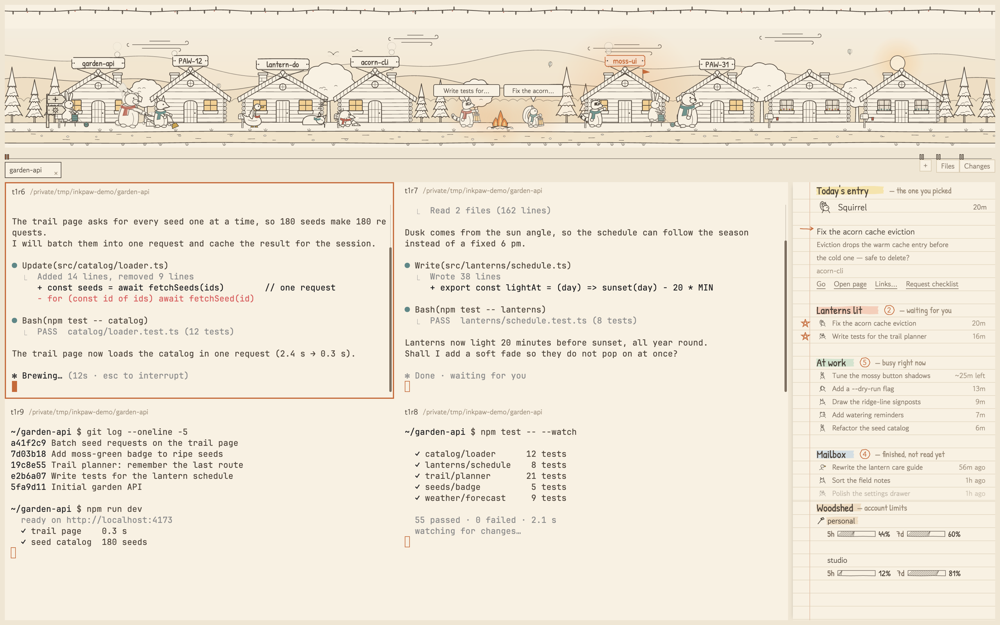

# Inkpaw Hollow

A cozy working forest for Herdr. Eight little cabins sit along a path under drifting clouds, and every terminal is an animal that works, rests, waits or comes home. A clothesline of paper tabs hangs above the desk, a ruled-paper notebook on the right keeps one page per session, and a woodshed under it shows two account windows as pencil gauges. Everything is drawn as warm ink on cream paper: no icons, no boxes, no white.

## What you see

The window is one row with `chrome` behind everything, no title bar, traffic lights at 12 and 16 px, and 8 px of padding and gap around the blocks.

**Top, 240 px tall (180–320), full width, drags the window:** the forest band is a 1600×200 drawing scaled to fit, pinned to the block's bottom edge. Cream paper `#f8f1e3`, a pale sky, four drifting clouds, three birds swapping two poses, drifting leaves, a hedge, pines and round trees, and a ground line. Eight cabins (`#4b4239` ink outlines on paper) stand along a path; a campfire burns at the centre with a breathing glow and two flickering flame poses. Each cabin has a mailbox and a hanging wooden signboard: cream planks with a 1 px ink border, up to three rows, 12 px rows at scale 1, 11 px type in Gowun Dodum. A cabin whose space is busy has three puffs of chimney smoke. A cabin with a finished session has its mailbox flag up. A signpost at the left edge (x = 40) carries a `+` plank for a new space and a gear for settings. While a search is active, a small sign in the top-right sky reads `Looking for: <query>` with a count; `?` draws a slip of paper beside it that lists the keyboard help in three columns. While the forest holds the keyboard, a wooden plank like the cabin signboards drops from the top vine on two strings (420 ms), reading `in the forest` and `← → walk · Space visit · ↩ go · ? more`; it rises away in 260 ms when the keyboard leaves.

**Under the forest, 44 px:** the tab bar is a clothesline. A hairline ink line runs across the top 10 px, and every tab is a cream paper tag 27 px tall hanging from two 3×9 px wooden pegs. Tags fit up to 28 characters; longer names truncate. The active tag drops 4 px and its pegs turn accent `#c46a3a`; a second tag border in the same accent marks keyboard focus. The empty tag at the end (`+`) opens the new-tab menu.

**Middle:** the desk holds the active tab's panes. Its 28 px pane header is a bare pencil label (no frame): program name 13 px ink, live folder 12 px faint behind it, then a status word. The focused pane gets a 2 px accent border.

**Right of the desk, hidden until asked, 368 px (280–900):** a stack of Herdr's shipped `files` and `changes` blocks, defaulting to Files. The tab bar shows paper Tags for both.

**Far right, 340 px (280–480), resizable:** one continuous cream page, radius 10, shadow sm. The notebook is 22 px ruled paper with a red margin line at x = 28, 40 px of left padding and 14 px of right padding. It opens with **Today's entry** in a 28 px row level with the pane header: the chosen session's animal face, the animal's name, its time, a 14 px bold topic over up to two lines, a lead line over three, ticket and PR tags, a stepping-stone checklist, a faint footer, and words: **Go**, **Open page**, **Links…**, **Request checklist**, **Stop**. Under it come **Lanterns lit**, **At work** and **Mailbox**, each row 22 px on the rules: a 16 px animal face, the topic, a time, and **Snooze** on quiet rows. Mailbox keeps five letters and offers **N more letters**; a viewed letter is 50 % transparent.

**At the bottom of the page, 200 px:** the **Woodshed**. It continues the same 22 px rules and margin line. Each account takes two 22 px lines, with one blank 22 px line between accounts: the first carries the axe on the account this pane runs as and its name in 13 px, swept with a wood-coloured highlighter; the second carries the two rate-limit windows, each a 64×10 pencil-outlined gauge filled with hatching up to the share used, with its label and percentage in Patrick Hand 14 px.

Type and colour come from `themes/inkpaw-hollow.json`: background `#f8f1e3`, foreground `#4b4239`, accent `#c46a3a`, selection `#e6d8bd`, chrome `#efe6d4`, canvas `#e9dfcb`, border `#d8cab0`, hover `#e8ddc8`, muted `#7d6f60`. Gowun Dodum (OFL) draws all of the prose, and the woodshed's labels and percentages are hand-written in Patrick Hand. Each mod that draws type carries `fonts/GowunDodum-Regular.ttf` and its licence.

## How it behaves

**Forest statuses.** Working: the animal plays its work pose and its cabin smokes. Blocked: the animal stands around the campfire, a warm glow breathes over it, and a paper speech bubble shows its title; bubbles stack in three levels so neighbours do not overlap. Done: the animal waves, the mailbox flag is up, and its tag in the tab bar gains a red thread knot. Idle: the animal sleeps with three drifting `z`s. An agent whose status report has stopped (claude, codex, pi, gemini, opencode, aider) still gets its animal, which rests like an idle one and is not counted in the notebook's lists. The animal picked with the forest's keyboard turns to face you, waves, hops once and grows to 1.4× while the forest holds the keyboard; it shrinks back the moment the keyboard leaves. A lantern-lit blocked animal stays at the campfire even when its cabin is far away; past 44 visible animals the rest count into `+N`.

**Notebook statuses.** A waiting session is a lantern in **Lanterns lit**; a busy one is at work in **At work**; an idle or finished one falls into **Mailbox**. A busy session with no background work and ten quiet minutes becomes a stall: it stays in **Lanterns lit** with `Quiet Nm` and a **Snooze** word, and Snooze parks it for ten minutes. The checklist shows one stone per step, the current step blinking, with its `3/7` count; ↑ on a selected letter opens the seven steps in a 6-row window.

**Tab and shelf marks.** A working tab has a firefly dot blinking over 1600 ms; a blocked tab a solid accent dot; a done tab the thread knot. The pane header writes `working` with three blinking dots, `waiting` for blocked, `done` for done.

**Woodshed.** From 90 % a window's hatching and percentage turn the accent `#c46a3a`, a red `#b9614f` star appears, and its reset time is written as `resets 2am` (clock time within a day, else the weekday). A 5h or 7d window at 100 % adds `rate-limited` and the reset time to the row's hover note. Clicking a shed row opens the accounts note.

**Clicks.** An animal focuses its pane. A cabin signboard row selects that space (and that tab when it has one); right-click opens Herdr's space menu. The `+` plank makes a space; the gear opens settings. A tab selects on click, moves on drag, renames on double-click; right-click opens the tab menu. A journal row selects and focuses its session; its right-click opens the links note. Mailbox's **N more letters** reveals the rest. The woodshed row opens the accounts note.

**Keys (when a block has the keyboard).**
- Forest: `←` `→` walk between animals, `⌥←` `⌥→` jump to the first or last, `Space` the session that waited longest for a reply, `⇧Space` the oldest finished one, `↩` go to it, `Esc` step back (query, then selection, then down to the terminal), `⌘⌫` clear the search, `?` fold the help note. Typing searches across topic, title, space, tab, path, ticket and PR.
- Notebook: `↑` `↓` choose (and scroll steps), `Space`/`⇧Space` the same jumps as the forest, `↩` go, `⌘↩` links, `⇧↩` open the page, `Tab` the oldest page, `⌫` mark read or snooze, `Esc` clear, `⌘Z` undo the last notice.
- Tabs: `←` `→` move and wrap, `↩`/`Space` select.
- Links note: a row's letter (`J` ticket, `P` PR, `G` page, `C` checklist, `X` stop), `↑` `↓`, `↩`, `Esc`.

**Hovers.** An animal names its topic and status; a signboard row names its space, crew and idle shells; a shed row names both windows and whether the account is rate-limited. The pane header turns its four words (`right`, `down`, `zoom`, `close`) from pencil grey to ink under the pointer. Journal words underline on hover.

**Motion.** Animals walk slowly between spots (900–9000 ms, linear). Each is two SVG poses cross-fading over an opaque paper silhouette, with a slight breathing scale when still. Clouds drift 18–32 px over 38–64 s, birds bob 4 px, leaves fall 70 px and drift 26 px, smoke rises and fades, the campfire glow breathes 3400 ms, speech bubbles rise 2 px over 3000 ms, the firefly pulses 1600 ms, and working dots and stones blink. Every motion is a native Herdr `loop`; nothing animates in JavaScript.

## Built from

The layout is `layouts/inkpaw-hollow.json`: a root `row` with `theme: "inkpaw-hollow"`, `background: "chrome"`, `titlebar: "none"`, `traffic_lights: [12, 16]` and `preview: "layouts/inkpaw-hollow.png"`; its `work` column carries `padding: 8` and `gap: 8`.

- `forest`: block 240 px (min 180, max 320), `window_drag: true`, radius 10, background `surface`, content `{ mod: "inkpaw-forest" }`.
- `below` column, gap 6: `tabs` 44 px (`inkpaw-tabs`), then `content` row gap 8.
- `desk` column gap 6 → `main` block (background `background`, radius 10, shadow sm) whose content is `{ tab: "active", pane: { header: { content: { mod: "inkpaw-pane" }, reveal: "always", height: 28, position: "top" }, background: "background", focus: { width: 2, color: "accent" }, gap: 8, lone: true } }`.
- `panel` column 368 px (min 280, max 900), `hidden: true`, a `panel-body` stack with shipped `files` and shipped `changes`, active `files`.
- `notebook` column 340 px (min 280, max 480), `resizable: true`, gap 0, background `background`, radius 10, shadow sm: `journal` (`inkpaw-journal`) and `shed` 200 px (`inkpaw-shed`, props `{ "role": "shed" }`).

Each mod's role:

- **`inkpaw-forest`** — the band. Pure logic in `forest.js` (sign rows, search, repo fences, keyboard order) and `scene.js` (hash → animal and scarf, status → mood, placement); `main.js` draws. Calls `agents()`, `spaces()`, `terminals()`, `panes()`, `focused()`, `shared`/`setShared("inkpaw")`, `openOverlay({ mod: "menu" })`, `nextCommand()`, and `run("space.select" | "tab.select" | "space.new" | "app.settings" | "pane.focus" | "pane.go")`. Every 30 s it runs `git -C <cwd> rev-parse --path-format=absolute --git-common-dir --show-toplevel` to draw repository fences and keep one repository's spaces together.
- **`inkpaw-journal`** — the page. Runs `sh <appHome>/mods/inkpaw-journal/scan.sh` every 3 s. `SCAN` reads Claude Code session records and transcripts, Codex rollouts and Gemini chats, an optional checklist file, page alerts and the processes' environment (`ps`, `lsof`), and prints one JSON line per session. The notebook also calls `exec("open", [url])` and `exec("rm", ["-f", …])` for page alerts, `exec("sh", ["-lc", 'hc send …'])` for its checklist button, `exec("sh", ["-lc", 'claude stop …'])` for Stop, `tmux` for tmux panes, and `open -a Orca` with the Orca CLI for Orca panes.
- **`inkpaw-shed`** — the woodshed. Runs the bundled `cca` (`--porcelain [pid]`) every 30 s; `cca` reads Claude and Codex account configs, rate-limit records and, when `node` and macOS `security` are present, asks the optional Anthropic usage endpoint. `role: "shed"`; the same mod's `menu` role is the accounts note that the keyboard shortcut opens.
- **`inkpaw-tabs`** — the clothesline bar. A fork of Herdr's shipped `tabs` with the same commands (`tab.select`, `tab.move`, `tab.close`, `layout.show`/`hide`/`select`, `window.*`) and per-space panel memory in `localStorage`.
- **`inkpaw-pane`** — the 28 px pane header, props `{ pane, terminal }` from the app; focus, split, zoom and close via `run`.
- **`inkpaw-editor`** — not in this layout. It ships so the `hv` launcher can open a file in a pane beside its terminal; props `{ file }` or `{ file, tab }`, saves with `writeTextFile`.

Shipped mods used: `files`, `changes`, `menu`, `new-menu`. Art: 8 cabins, 8 animals × walk/work/wave/greet/lantern/sleep poses, props, clouds, birds, hedge, trees and fx (bubbles, glow, smoke, fire) as SVG under `mods/inkpaw-forest/art/`, plus faces under `mods/inkpaw-journal/faces/`. `mods/inkpaw-forest/data.js` holds the sizes, anchors and palette for that art.

The layout's `keys.json` section is `layout:inkpaw-hollow`: `ctrl-alt-p` → `inkpaw-forest.toggle`, `ctrl-shift-a` → `mod.open:inkpaw-shed`, `cmd-=`/`cmd-+` → `inkpaw-journal.font_in`, `cmd--` → `font_out`, `cmd-0` → `font_reset`, `cmd-[`/`cmd-]` → `back`/`forward`.

## Watch out

- **Eight cabins, 44 animals.** Up to eight spaces get their own cabin; more share in sidebar order. A cabin takes four animals at its door and path, the campfire twelve; everything else past 44 is hidden and only `+N` shows.
- **Three sign rows.** A board wider than its cabin or taller than the space between roof and ground drops to two rows and counts the rest into `+N`; planks are divs, not SVG, because `image()` keeps aspect ratio and could not grow to a label.
- **`git` and `python3` are required.** The forest asks `git` every 30 s; the notebook's `scan.sh` exits with a meta error when `python3` is missing. `ps` and `lsof` must exist for Codex/Gemini and tmux detection, and are overridable with `PULSE_PS`/`PULSE_LSOF`.
- **The woodshed is optional.** Without the bundled `cca`, or without `node`, it shows `cca not found: …` or no windows; the rest of the layout still works. The Fable window and the email/plan lines are macOS-only (`security`, keychain). The usage endpoint is the layout's only network call, at most once per 5 minutes.
- **Optional integrations.** The checklist needs a `deadhd` state file (default `/tmp/deadhd-state/<session>.json`, override `DEADHD_STATE_DIR`); page alerts default to `~/.pulse/pages` (override `PULSE_PAGES_DIR`). Codex windows come from `~/.codex/sessions`; Gemini from `~/.gemini`.
- **Herdr version.** The layout relies on per-pane headers (`header` on the `pane` object), `pane.lone`, `layout.resize`, `loop`, `frames` and `image()` sizing from this 0.1.x generation. A fresh build on a different version should re-check those fields first.
- **Fonts ship with the mods.** Every mod that draws type carries Gowun Dodum and its OFL text; copying a mod without `fonts/` makes Herdr fall back and the page rules shift.
- **Demo fixtures ship but stay inert.** The forest, the notebook and the woodshed each carry a `demo.js` fixture that draws only when the block's props set `demo: true` (used for screenshots). This layout never sets it, so it always reads live data.
- **The panel starts hidden.** It comes back per space from the tab bar's Files/Changes tags; `ctrl-shift-b` is Herdr's own sidebar toggle, not this layout's.

## Done when

- `herdr-app check` passes for `mods/inkpaw-forest`, `mods/inkpaw-journal`, `mods/inkpaw-shed`, `mods/inkpaw-tabs`, `mods/inkpaw-pane` and `mods/inkpaw-editor`.
- `herdr-app do layout.switch --name inkpaw-hollow` shows the forest above the desk, the clothesline, the notebook and the woodshed, with the 240 px forest and 340 px notebook at their stated minimum and maximum sizes.
- An agent in a space makes its animal work and its cabin smoke; blocking it moves the animal to the campfire with a lantern, a speech bubble and a **Lanterns lit** row; finishing it makes the animal wave, raises the mailbox flag, ties the tab knot and puts a **Mailbox** row in the notebook.
- `ctrl-alt-p` moves the keyboard into the forest and back out; `←`/`→` walk the firefly between animals; `?` folds and unfolds the help note; `ctrl-shift-a` opens the accounts note.
